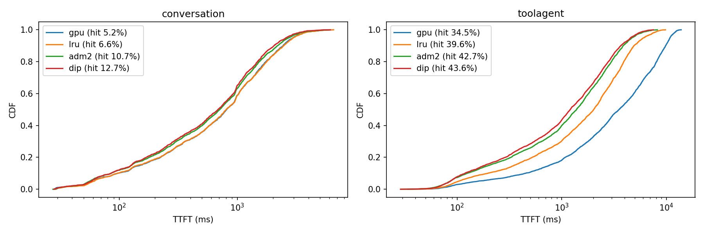

# Eviction Policies for vLLM's CPU KV-Cache Offload Tier

Prefix caching lets an LLM server skip prefill for context it has already processed, such as
system prompts, earlier chat turns and agent loops. This project studies which KV chunks are worth
keeping when the cache is full. It uses public production traces from Kimi (Mooncake, FAST'25) and
vLLM 0.30's offload code, and adds DIP-KV, an adaptive admission policy that plugs into vLLM through
its out-of-tree `CachePolicy` API without forking vLLM.

## Results

Measured on vLLM 0.30 with an A100, replaying Kimi production traces. Compared with vLLM's default
LRU policy, DIP-KV reduced p50 / p95 time-to-first-token (TTFT) by 40% / 25% on agentic traffic
and by 15% / 13% on chat traffic.



| Workload | Policy | Prefix hit rate | p50 TTFT (ms) | p95 TTFT (ms) |
|---|---|---|---|---|
| Chat | vLLM LRU | 6.6% | 806 | 2,979 |
| Chat | DIP-KV | 12.7% | 686 | 2,591 |
| Tool-agent | vLLM LRU | 39.6% | 2,023 | 6,083 |
| Tool-agent | DIP-KV | 43.6% | 1,209 | 4,550 |

All runs, including the GPU-only and vLLM admission-filter baselines, are in
[`results/gpu/final_results.csv`](results/gpu/final_results.csv). The setup is described
[below](#gpu-benchmark).

## Key findings

1. **Eviction policy barely matters for a single GPU's KV cache.** At GPU-memory capacity, LRU,
   LFU and cost-aware GDSF give the same hit rate on every trace. About 85% of cached chunks are
   never reused, and the ones that are come back a median of about 70 seconds later, which is
   longer than they survive in GPU memory. The policy starts to matter in the much larger CPU
   offload tier (vLLM `OffloadingConnector`, LMCache-style).
2. **vLLM's ARC policy performs no better than LRU, because it never fills its "frequent" list.**
   In the textbook algorithm (Megiddo and Modha, FAST'03), a chunk requested again soon after
   being evicted (a hit in a ghost list) goes back into the "frequent" list T2. vLLM's ARC only
   adjusts its target size on such a hit and then re-inserts the chunk into the "recent" list T1.
   Here reuse usually arrives after the chunk was already evicted, so T2 stays nearly empty (fewer
   than 20 chunks at small capacity) and ARC behaves like LRU. Sending ghost hits to T2, a one-line
   change, raised ARC's hit rate by up to 3 points on both traces in simulation.
3. **vLLM's `store_threshold=2` admission filter helps at small capacity and hurts at large
   capacity.** On chat traffic with 16,000 chunks it lowers the hit rate from 27.3% to 21.6%.
4. **Evicting a chunk from the middle of a prefix wastes every chunk after it.** Restricting the
   LHD policy to evict only the last chunk of a prefix raised its hit rate from 11% to 24% on the
   synthetic trace.
5. **DIP-KV matches or beats LRU on both real traces at every capacity.** New chunks start on
   probation, a ghost list of recently seen keys lets returning chunks in directly, and small
   sampled shadow caches decide online whether this beats plain LRU. At small and medium capacity
   it reaches up to 2x LRU's hit rate; at large capacity it falls back to LRU.

### Simulated CPU-tier hit rate, full 1-hour traces (512-token chunks)

| Trace | Chunks | LRU (vLLM) | ARC (vLLM) | LRU + admission (vLLM) | LHD (prefix-aware) | DIP-KV | Belady (oracle) |
|---|---|---|---|---|---|---|---|
| chat | 1,000 | 4.6% | 5.1% | 5.8% | 6.4% | **8.0%** | 17.5% |
| chat | 2,000 | 5.6% | 6.0% | 9.5% | 8.2% | **11.3%** | 25.2% |
| chat | 4,000 | 9.1% | 8.9% | 15.3% | 12.3% | **15.6%** | 32.4% |
| chat | 16,000 | 27.3% | 27.3% | 21.6% | 26.6% | **27.2%** | 37.3% |
| tool-agent | 1,000 | 35.2% | 35.5% | 36.2% | 35.7% | **37.8%** | 44.4% |
| tool-agent | 4,000 | 39.0% | 36.9% | 43.3% | 39.2% | **43.1%** | 55.0% |
| tool-agent | 16,000 | 52.2% | 51.9% | 47.0% | 48.8% | **52.1%** | 57.0% |

Full tables are in `results/tier_*.csv`. On the short synthetic trace (4k requests) DIP-KV can
trail LRU by up to 2 points, because its adaptive switch has less traffic to learn from.

`tests/test_real_manager.py` replays the traces through vLLM 0.30's real `CPUOffloadingManager`.
Every policy matches the simulator within 0.15 points, and vLLM's own LRU and admission filter
match to four decimal places. Both follow vLLM's call order: a request's keys are touched again
right after a store is prepared, while the copy to CPU memory is still in flight.

## GPU benchmark

Model: Qwen2.5-1.5B-Instruct served with `vllm serve` on an A100-80GB. The CPU offload tier holds
500 chunks of 512 tokens (about 7.3 GB of pinned host memory), and the GPU KV pool is kept small
(about 98k tokens) so the CPU tier matters. Each trace is replayed open-loop with its real arrival
pattern, using a 1/4 session sample and a time compression chosen by calibration. Every policy sees
identical traffic. Hit rates come from vLLM's Prometheus counters and agree with the per-request
`cached_tokens` values.

| Workload | Policy | GPU-tier hits | CPU-tier hits | Total hit rate | Simulator prediction | p50 TTFT (ms) | p95 TTFT (ms) | p99 TTFT (ms) |
|---|---|---|---|---|---|---|---|---|
| Chat | GPU cache only | 5.2% | 0.0% | 5.2% | | 812 | 2,955 | 4,263 |
| Chat | vLLM LRU | 5.2% | 1.4% | 6.6% | 6.6% | 806 | 2,979 | 4,310 |
| Chat | vLLM admission filter | 5.2% | 5.6% | 10.7% | 10.7% | 711 | 2,714 | 3,879 |
| Chat | DIP-KV | 5.2% | 7.5% | 12.7% | 12.0% | 686 | 2,591 | 3,693 |
| Tool-agent | GPU cache only | 34.5% | 0.0% | 34.5% | | 3,532 | 10,839 | 12,357 |
| Tool-agent | vLLM LRU | 34.9% | 4.7% | 39.6% | 39.7% | 2,023 | 6,083 | 8,130 |
| Tool-agent | vLLM admission filter | 35.1% | 7.7% | 42.7% | 42.8% | 1,386 | 4,690 | 6,463 |
| Tool-agent | DIP-KV | 35.1% | 8.5% | 43.6% | 43.3% | 1,209 | 4,550 | 6,001 |

Notes:

* With vLLM's default LRU, the CPU tier adds almost nothing on chat traffic: 1.4 points of hit rate
  and the same latency as using the GPU cache alone. DIP-KV gets 5.4 times as many hits out of
  the same CPU tier.
* The two workloads ran at different load levels. Chat stayed stable for every policy (median
  TTFT of 0.6 to 0.7 s in the first 10% of requests and 0.9 to 1.1 s in the last 10%). Tool-agent
  ran close to saturation: median TTFT climbed from 2.7 s to 9.2 s over the run with the GPU cache
  alone and from 1.4 s to 2.1 s with LRU, while DIP-KV stayed between 1.1 and 1.3 s. Near capacity,
  every token of prefill saved also shortens the queue, so latency gains are larger.
* Without prefix caching, tool-agent at this load does not keep up (p50 TTFT of 133 s).
* At most 10 of 5,810 requests failed in any run, all under peak load.
* Limitations: 1.5B model on one GPU; 1/4 session sample with the CPU capacity scaled by the same
  factor (checked offline to preserve hit-rate curves); prompts truncated to 30k tokens with the
  prefix kept; outputs capped at 64 tokens; token contents are synthetic because the traces only
  publish block hashes, but the sharing structure is real.

## Layout

```
kvpolicy/      vLLM CachePolicy plugins: dip.py (DIP-KV and its ablation), lhd.py, probe.py (logging)
kvsim/         simulators: tier_sim.py (CPU tier, runs real vLLM policy classes), run.py and cache.py (GPU radix cache)
vllm_stub/     vLLM 0.30 LRU and ARC policy files plus a small stub, for offline runs
bench/         GPU benchmark: prep.py (session sampling), run.py, calibrate.py, predict.py
colab/         kv_offload_benchmark.ipynb (A100, resumable, results saved to Google Drive)
tests/         replay through vLLM's real offload manager, fake vLLM server for harness tests
results/       simulation CSVs; results/gpu/ has the measured GPU results
```

## Reproduce

```bash
./scripts_get_traces.sh
python kvsim/tier_sim.py --trace traces/conversation_trace.jsonl --out results/tier_conversation.csv
# GPU runs: open colab/kv_offload_benchmark.ipynb in Colab (A100, High-RAM)
```

Using DIP-KV in vLLM:

```bash
PYTHONPATH=. vllm serve <model> --kv-transfer-config '{"kv_connector":"OffloadingConnector","kv_role":"kv_both",
  "kv_connector_extra_config":{"cpu_bytes_to_use":8e9,"block_size":512,
  "eviction_policy":"DIPCachePolicy","cache_policy_module_path":"kvpolicy.dip"}}'
```

## Status

- [x] Trace analysis, simulators, policies, validation against vLLM's real offload manager
- [x] GPU runs with measured TTFT and hit rate
- [ ] Confirmation run on a 7B model
- [ ] Report to vLLM that its ARC re-inserts ghost hits into T1 instead of T2
